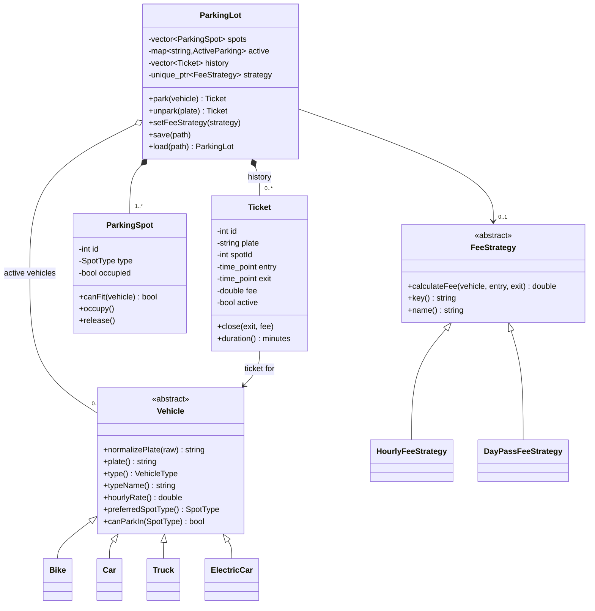

# Parking Lot Management System

A console-based C++17 project that demonstrates object-oriented design through
a parking lot reservation and billing workflow.

The lot starts with **12 spots**:

| Spot type | Count | Compatible vehicles |
|---|---:|---|
| Compact | 4 | Bike |
| Regular | 4 | Bike, Car, Electric car |
| Large | 2 | Car, Truck |
| EV | 2 | Electric car |

## Features

- Park and unpark four vehicle types: Bike, Car, Truck, Electric car
- Automatic spot assignment based on vehicle/spot compatibility, preferring
  each vehicle's native spot type (for example, an electric car prefers an EV
  spot before falling back to a regular spot)
- Unique ticket for every parking session, with entry/exit time and fee
- Two runtime-swappable fee strategies (Strategy pattern)
- Lot status, active tickets, completed tickets, revenue and average stay
- Text-file persistence with automatic save after parking changes
- Typed exception hierarchy for full lot, unknown vehicle, duplicate plate,
  invalid input, invalid state and file errors
- Unit-style assertions for rules, billing, compatibility and persistence

## Build and run

Fedora:

```bash
sudo dnf install -y gcc-c++ make
cd ~/parking-lot
make
./parking_lot
```

Run the tests:

```bash
make test
```

If the host has no compiler but has Podman, the project can be built in a
container:

```bash
podman run --rm -it -v "$PWD:/work:z" -w /work fedora:44 \
  bash -c 'dnf -y install gcc-c++ make && make && make test'
```

`make clean` removes the binaries.

## Menu

```text
1) Park a vehicle
2) Unpark a vehicle
3) Show lot status
4) Show active tickets
5) Show completed tickets
6) Show summary
7) Change fee strategy
8) Save state now
9) Reload saved state
0) Exit
```

The lot is saved automatically after every successful park, unpark and fee
strategy change, and when the program exits. It is loaded automatically at
startup from `data/parking_state.txt`.

## Tariff rules

| Vehicle | Hourly rate | Compatible spots |
|---|---:|---|
| Bike | 10.00 | Compact, Regular |
| Car | 20.00 | Regular, Large |
| Truck | 40.00 | Large |
| Electric car | 25.00 | EV, Regular |

- **Hourly strategy:** billable hours are rounded up, with a minimum of one
  hour and a maximum of eight hours per ticket.
- **Day-pass strategy:** flat 120.00 per ticket.
- The strategy active when a vehicle is unparked determines its fee.
- Plates are normalized by removing punctuation/spaces and converting to
  uppercase. `MH-12-AB-1234` and `mh12 ab 1234` are the same plate.
- A vehicle can have only one active ticket at a time.

## Project layout

```text
parking-lot/
├── include/
│   ├── Exceptions.h
│   ├── FeeStrategy.h
│   ├── ParkingLot.h
│   ├── ParkingSpot.h
│   ├── Ticket.h
│   ├── TimeUtils.h
│   ├── Types.h
│   ├── Vehicle.h
│   └── VehicleFactory.h
├── src/
│   ├── FeeStrategy.cpp
│   ├── main.cpp
│   ├── ParkingLot.cpp
│   ├── ParkingSpot.cpp
│   ├── Ticket.cpp
│   ├── TimeUtils.cpp
│   ├── Types.cpp
│   ├── Vehicle.cpp
│   └── VehicleFactory.cpp
├── tests/
│   └── test_core.cpp
├── data/                    # created automatically
├── Makefile
└── README.md
```

## Class design



`VehicleFactory` creates the correct `Vehicle` subclass when a plate is entered
or when saved state is loaded. `Ticket` is a value object: active tickets live
inside `ParkingLot::active_`, and completed tickets are copied into history.

## OOP concepts used

| Concept | Where it appears |
|---|---|
| Abstraction | `Vehicle` and `FeeStrategy` are abstract base classes with pure virtual functions |
| Encapsulation | `ParkingSpot` keeps occupancy private; `Ticket` enforces a one-time `close()`; only `ParkingLot` mutates lot state |
| Inheritance | `Bike`, `Car`, `Truck`, `ElectricCar`; `HourlyFeeStrategy`, `DayPassFeeStrategy` |
| Polymorphism | Active vehicles are stored as `std::unique_ptr<Vehicle>` and used through virtual `hourlyRate()`, `preferredSpotType()`, `canParkIn()`, `typeName()`; `ParkingLot` calls `FeeStrategy::calculateFee()` through a base reference |
| Composition | `ParkingLot` owns its spots, active ticket/vehicle pairs, history and fee strategy |
| Constructors/destructors | Virtual `~Vehicle()`; RAII through `std::unique_ptr` and `std::ofstream`/`std::ifstream` |
| Exceptions | `Exceptions.h` defines a custom hierarchy rooted at `ParkingException`; CLI catches and reports without crashing |
| Operator overloading | `Ticket::operator<<`, `operator==`, `operator<`; `Vehicle::operator==` |
| Function overloading | `Ticket::duration()` for the current/exit time and `Ticket::duration(TimePoint)` for an arbitrary time |
| Static members | `Ticket::nextId_` gives unique ticket IDs; `setNextId()` restores the counter after loading |
| STL | `std::vector`, `std::map`, `std::sort`, `std::find_if`, `std::count_if`, `std::accumulate` |
| File handling | `ParkingLot::save()` / `load()` persist spots, strategy, active tickets, history and revenue |
| Design patterns | Strategy (fee strategies), Factory (vehicle creation), RAII (smart pointers/streams) |

## Persistence format

`data/parking_state.txt` is a line-oriented text file. It is written by
`ParkingLot::save()` and should not be edited by hand.

```text
PARKING_LOT 1
SPOTS 4
SPOT 1 Compact
SPOT 2 Regular
SPOT 3 Large
SPOT 4 EV
STRATEGY hourly
ACTIVE 1 MH12AB1234 Car 2 1761480000
HISTORY 2 KA01BB2222 1 1761470000 1761473600 10.00
REVENUE 10.00
END
```

Times are Unix timestamps; the program formats them for display. Loading
validates the header, spot references, vehicle/spot compatibility, duplicate
active plates, occupancy consistency and the final `END` marker.

## Tests

`make test` runs `tests/test_core.cpp`, which checks:

- plate normalization and duplicate detection
- spot compatibility for all four vehicle types
- full-lot and unknown-vehicle exceptions
- minimum one-hour fee and both strategies
- save/load round-trip, including active tickets, history, revenue and strategy
- missing-file error handling

## Design notes for a viva

- **Why an abstract `Vehicle`?** The lot can treat all vehicles uniformly while
  each subclass owns its rate and spot compatibility. Adding a new vehicle type
  requires one subclass and one factory case, not changes to `ParkingLot`.
- **Why a `FeeStrategy` instead of an `if` chain?** Pricing changes
  independently of vehicle type. The Strategy pattern avoids a class explosion
  such as `CarHourly`, `TruckDayPass`, and so on.
- **Why `std::unique_ptr`?** It expresses exclusive ownership and provides
  RAII. `ParkingLot` does not need a manual destructor or `delete`.
- **Why is `ParkingLot` non-copyable?** It owns a map of `unique_ptr<Vehicle>`
  and a `unique_ptr<FeeStrategy>`; copying would double-own them. Copy is
  deleted and move is defaulted.
- **Why a virtual destructor?** Vehicles are destroyed through
  `unique_ptr<Vehicle>`; without a virtual destructor, derived destructors
  would not run correctly.
- **How is exception safety handled?** Validation happens before state changes.
  A new ticket is fully constructed before the spot is occupied. During
  unparking, the closed ticket is added to history before the active record is
  erased, so a failed allocation leaves the active state intact.
- **Why normalize plates?** Users type punctuation inconsistently; normalized
  keys make duplicate checks, lookup and persistence consistent.

## Known limitations

- Single process, single-threaded; no concurrency control
- Fixed demo tariff and an eight-hour cap per ticket
- No multi-day billing or reservations for a future time
- Console interface only
